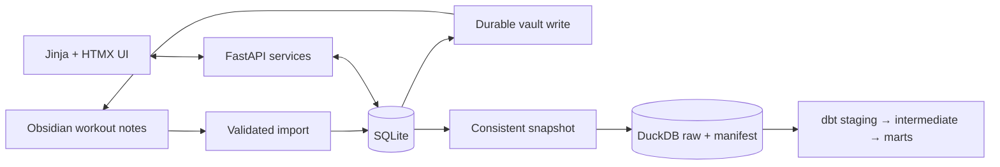

# Architecture and data ownership

SQLite owns app drafts, statuses, actual results, imported provenance, and retryable
vault writes. SQLAlchemy repositories isolate persistence; services handle workout
rules and publication; FastAPI transports commands and renders Jinja/HTMX fragments.
Alembic owns operational schema changes.

Only a finished session is published as a dated Obsidian note. Results are first
persisted with a pending write; file publication is then acknowledged in SQLite.
Interrupted acknowledgement is recovered by matching session identity/content.
Failed saves remain finalizing and cannot advance the next workout. Existing
differing notes are conflicts, never overwritten. A complete temporary file is
published with a same-directory, no-clobber hard link; Windows/NTFS and WSL support
this path. Unsupported filesystems surface an error and preserve the pending write.

Templates and existing notes are read-only import sources. An optional, explicitly configured
legacy cutoff confirms historical notes through a reviewed date. Without a cutoff,
unmarked notes require explicit completion review. Changed imported checksums are reported rather
than silently replacing results. App metadata and numeric result lines must agree.

Recorded exercises have stable identities and ordered per-routine set keys. Legacy
sets map only when an exercise's set count matches the template; missing middle
sets have unknown planned identity. Prefills still reuse those observed values in
recorded order and label that assumption; only additional sets use template values.
New notes retain
planned-set metadata, including skipped/removed positions. Removal is session-only.

The web process binds to loopback, checks trusted hosts and mutation origins, and
accepts file targets only from validated session dates/routines. No vault directory
is exposed as static assets. The local port is configurable.

Analytics is downstream, never invoked by recording requests. A read-only SQLite
transaction extracts contracted tables, preserving IDs, statuses, and row order.
Content hashes make unchanged snapshots idempotent. DuckDB loads all tables and
publishes the manifest in one transaction; dbt selects the newest complete snapshot.
Private source text and pending-note contents are excluded from warehouse extracts.

Synthetic fixtures use a separate DuckDB file. Real snapshots and generated docs
remain ignored. Model descriptions and tests define grain, relationships, completion
filters, and recorded external-load volume. The hosted BigQuery/dbt Platform path
is a documented future milestone; no cloud dependency is required to record.
